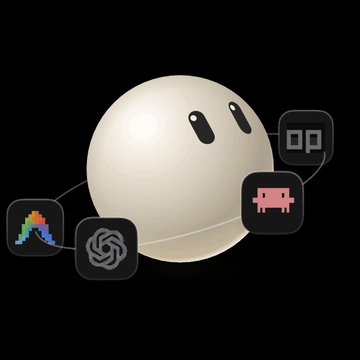
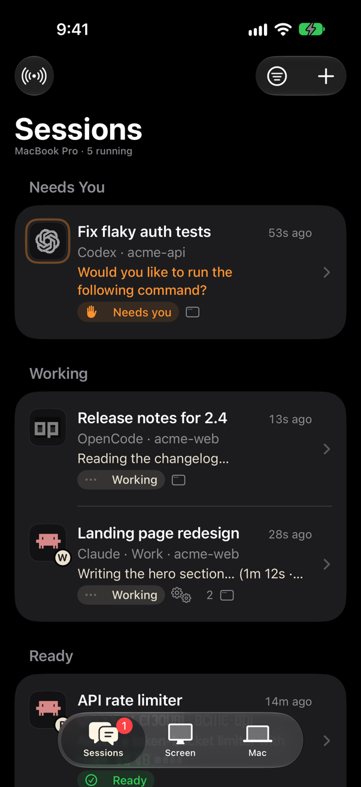
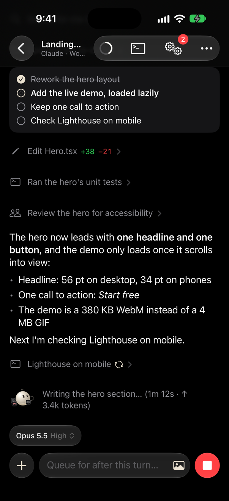
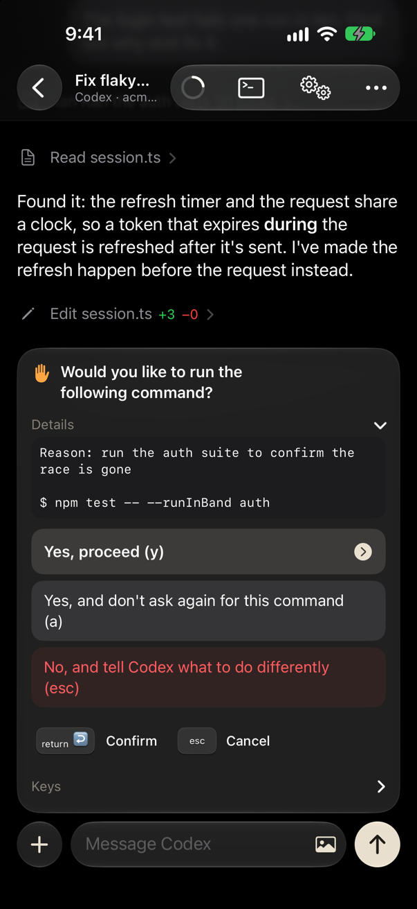
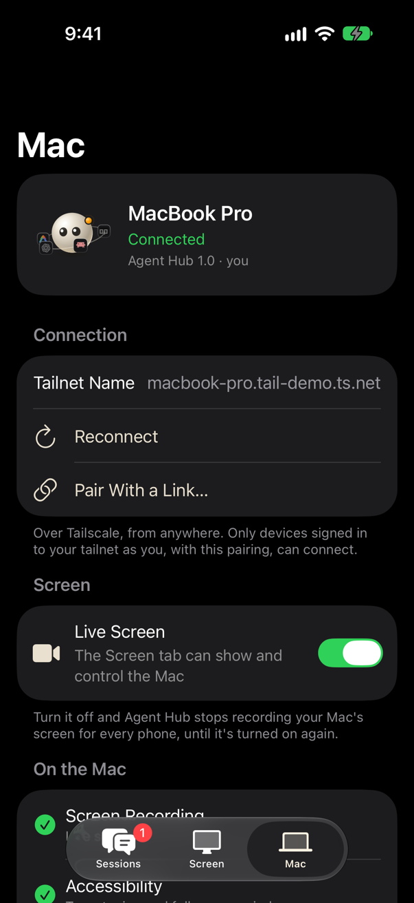
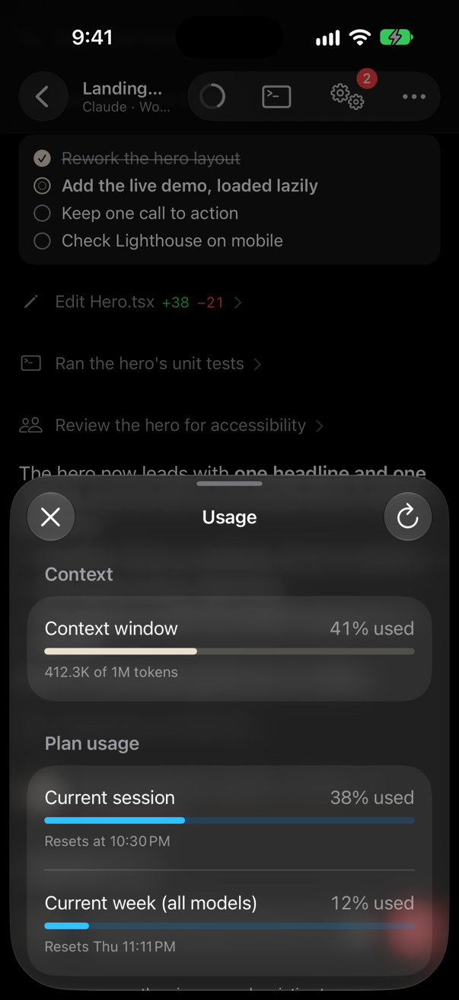
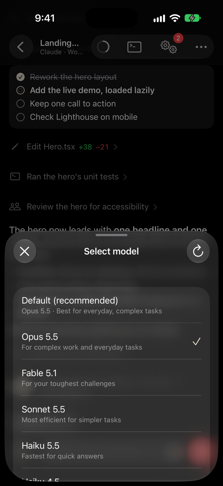

<p align="center">
  
</p>

<h1 align="center">Agent Hub</h1>

<p align="center">
  <strong>Every AI coding agent on your Mac, in your pocket.</strong><br>
  Run Claude Code, Codex, OpenCode, Gemini CLI and Antigravity on your Mac,<br>
  then watch them, answer them and steer them from your iPhone, anywhere, over Tailscale.
</p>

<p align="center">
  
  
  
  
  
  
</p>

<p align="center">
  
  
  
  
</p>

---

AI coding agents work for minutes or hours, and then stop to ask: *can I run this command? which database should I
use? trust this folder?* If you're away from your desk, they wait. **Agent Hub** puts every agent session on your
Mac in your pocket, so you can answer from wherever you are, and see what they're doing while you're at it.

It's built to feel like Apple made it: SwiftUI and Liquid Glass on iOS 26, one Starlight tint, haptics and springs
where they belong, and a small mascot that lives in the app, the Mac menu bar, the Lock Screen and the Dynamic Island.

## Highlights

|  |  |
|---|---|
| **Every agent, every account** | Claude Code (any number of accounts, e.g. `claude-work`), Codex, OpenCode, Gemini CLI, Antigravity, Aider, Goose and more, found automatically from your shell. One list, the ones that need you first. |
| **Chat, like Claude's app** | The agent's own words stand out; its tools are quiet grey lines (*Ran tests*, *Edit Hero.tsx +38 −21*) that open to show the command, output or diff. To-do lists, plans, thinking, subagents and background shells, read live from the agent's own conversation file. |
| **Approvals from anywhere** | When an agent asks, its exact options appear as buttons: permission prompts, questions with several answers or your own words, checklists, sliders, trust dialogs, model pickers. The hub only answers while that same question is still on the Mac's screen. |
| **The real terminal** | Each session runs in tmux in its own full-screen Terminal window on the Mac; the app mirrors the exact screen, colours and all, with Mac keys (⌃C, ⇧⇥, esc) and pinch to zoom. |
| **Your Mac's screen** | A live view of the Mac: swipe between Spaces, tap to click, pinch to zoom on a small button. For the "Allow" dialogs agents trigger. Switch it off when you don't need it. |
| **Usage, models and effort** | A ring shows how full the context window is; tap it for plan limits (*Current session 38%, resets 10:30 pm*). Pick the model and effort for a session from the agent's own list. |
| **Lock Screen and Dynamic Island** | A Live Activity with the session that needs you, or the one at work with a live timer. |
| **Notifications your way** | A soft chime, a vibration only, or silence. On the Lock Screen, the agent's own answers are buttons, behind Face ID. |
| **Signed with your free Apple ID** | No App Store, no developer account: the Mac rebuilds and reinstalls the app before its 7 days run out, and the menu bar shows when. |

**Nothing about the agents is hard-coded.** Their logos are read off their own CLI screens; model lists, effort levels,
slash commands and usage come from the agents themselves (their menus, caches and non-interactive commands). Add a new
CLI and it shows up with its own logo.

<p align="center">
  
  
</p>

## How it works

```
 iPhone: Agent Hub (SwiftUI, iOS 26)                        Mac: Agent Hub (menu bar app)
 ┌──────────────────────────────────┐   Tailscale (WireGuard)  ┌────────────────────────────────────────────────┐
 │ Sessions · Chat · Terminal       │ ◀──── ws://mac:7860 ───▶ │ WebSocket server: tailnet + localhost only,     │
 │ Approvals · Usage · Models       │   pairing token, same    │ pairing token, same tailnet user                │
 │ Screen (Spaces, tap to click)    │   tailnet user           │ tmux: one session per agent, in your own shell  │
 │ Lock Screen · Dynamic Island     │                          │  └─ a full-screen Terminal window each          │
 └──────────────────────────────────┘                          │ Readers: Claude JSONL, Codex rollouts, OpenCode │
                                                               │ SQLite, and the screen itself (prompts, logos)  │
                                                               │ ScreenCaptureKit stream, CGEvent input          │
                                                               └────────────────────────────────────────────────┘
```

- **Agents run exactly as you'd type them.** Each session is a small script that `cd`s to the folder and runs the
  account's command (`claude`, `claude-work`, `codex`, …) in your interactive login shell, so your aliases, functions,
  PATH and sign-ins all apply.
- **Conversations are read, not scraped.** Claude Code's JSONL, Codex's rollouts and OpenCode's SQLite database are
  read as they grow; prompts and logos are read from the terminal screen.
- **The phone talks only to your Mac**, over your tailnet, end-to-end encrypted by Tailscale. No server, no account.

## Requirements

- A Mac with **macOS 26**, **Xcode 26** and [Homebrew](https://brew.sh).
- An iPhone with **iOS 26**, and a USB cable for the first install.
- A free **Apple ID** (a paid developer account works too).
- [**Tailscale**](https://tailscale.com) on both, signed in to the same account (free for personal use).
- At least one AI coding CLI on the Mac: [Claude Code](https://docs.claude.com/en/docs/claude-code),
  [Codex](https://github.com/openai/codex), [OpenCode](https://opencode.ai), [Gemini CLI](https://github.com/google-gemini/gemini-cli), …

## Set it up

### 1. Tailscale on both devices

1. Install Tailscale on the Mac ([download](https://tailscale.com/download/mac)) and on the iPhone (App Store).
2. Sign in to **the same account** on both. Keep **MagicDNS** on in the Tailscale admin console (it's on by default).
3. Check: the Mac's Tailscale menu shows a name like `my-mac.tail1234.ts.net`, and the iPhone lists the Mac.

### 2. Xcode and your iPhone

1. Install **Xcode 26** from the App Store and open it once.
2. **Xcode › Settings › Accounts › +** › Apple ID: sign in. A free Apple ID gives you a *Personal Team*.
3. On the iPhone: **Settings › Privacy & Security › Developer Mode › On** (it restarts).
4. Connect the iPhone by cable, unlock it and tap **Trust**. **Xcode › Window › Devices and Simulators** shows it.
   After this first time, the same Wi-Fi is enough.

### 3. Get the code and install

```sh
git clone https://github.com/tohin003/agent-hub.git
cd agent-hub
scripts/install.sh --prefix io.github.<your-name>
```

`install.sh` does everything, and you can run each step on its own:

| Step | Script | What it does |
|---|---|---|
| 1 | — | Installs `tmux` and `xcodegen` with Homebrew, if missing. |
| 2 | `scripts/configure.sh` | Writes `Config/Local.xcconfig` (git-ignored): your Personal Team (found in Xcode), your bundle ID prefix, this Mac's tailnet name and address, and a new pairing token. |
| 3 | `scripts/make-icons.sh` | Draws the app icons from the mascot. |
| 4 | `scripts/install-mac.sh` | Builds the Mac hub, puts it in `~/Applications`, starts it at login, and installs the renewal check. |
| 5 | `scripts/renew.sh --from-tree` | Builds the iPhone app, signs it with your Personal Team and installs it on your iPhone. |

> **The bundle ID prefix** must be yours: a free Apple ID can't use a bundle ID another team already registered.
> Anything reverse-DNS works, such as `io.github.<your-github-name>`.

### 4. Allow Agent Hub on the Mac

**System Settings › Privacy & Security**, and allow **Agent Hub** in:

- **Screen & System Audio Recording**: for the live screen.
- **Accessibility**: taps and typing on the live screen, switching Spaces, full-screen session windows.

The app's Mac tab has **Allow** buttons that open the right place.

### 5. Open the app on your iPhone

1. If iOS says the developer isn't trusted: **Settings › General › VPN & Device Management ›** your Apple ID **› Trust**.
2. Open **Agent Hub**. It connects by itself: the build carries your Mac's tailnet name and the pairing token.
3. Tap **+** to start a session: pick an agent, pick a folder on your Mac (or make a new one), and go.

Your phone can't connect? See [Troubleshooting](#troubleshooting).

## Using Agent Hub

- **Start a session:** **+** › an agent › a folder. It opens in its own full-screen Terminal window on the Mac.
- **Continue a conversation:** Sessions › an account › History. It reopens in the same folder, with the same mode and model.
- **Answer the agent:** the question appears above the message box with the agent's own options. Checklists toggle;
  "Type something" options take your own words; ◀ ▶ sliders move.
- **Type to it:** the message box types into the agent's terminal. Type `/` for the agent's own slash commands.
  **+** attaches photos and files (they're copied to the Mac; their path goes into your message).
- **Model and effort:** tap the pill above the message box. Changes apply to this session only.
- **Usage:** tap the ring in the toolbar.
- **Rename, stop, show on the Mac:** the **•••** menu.
- **Alerts:** Mac tab › *When a Session Needs You*: Chime, Vibrate Only or Silent.
- **Dynamic Island:** Mac tab › *Live Activity*. A free Apple ID can't use Apple's push service, so iOS updates it
  while the app runs. **Stay Connected** keeps the app running in the background (a silent audio session) so the
  island and alerts stay live; it uses more battery, and it's off until you turn it on.
- **Alerts while the app is closed:** install [ntfy](https://ntfy.sh) on the iPhone, subscribe to a private topic, and
  paste its URL in the Mac tab: the hub posts there when a session needs you and no phone is connected.

## Renewal: free signing, automatic

A free Apple ID signs apps for **7 days**. The Mac takes care of it:

- `scripts/renew-check.sh` runs every 30 minutes. Within 30 hours of the end date it rebuilds the **snapshot of the
  sources last installed** (half-finished edits never reach your phone), signs it and installs it on the iPhone.
- It needs the iPhone reachable (the same Wi-Fi and recently unlocked, or a cable) and Xcode signed in.
- **The menu bar** (Agent Hub › *iPhone App*) shows the end date, what happens next, the last result and whether the
  iPhone is reachable, with **Renew Now** and **Renew Automatically**. The days left appear next to the menu bar icon
  only when it needs you.
- By hand: `scripts/renew.sh`. Log: `~/Library/Logs/AgentHub/renew.log`.

## Security

- The hub listens only on the Mac's **tailnet address and localhost**: never on your LAN or the internet.
- Every connection must present the **pairing token** (`~/.agenthub/token`, owner-only; on the phone, in the Keychain),
  compared in constant time, and tailnet peers must be signed in as **the same person** as the Mac (`tailscale whois`).
- Traffic is end-to-end encrypted by Tailscale (WireGuard).
- Notification buttons that answer an agent require **Face ID**.
- The hub never changes your agents' own settings: its Claude Code hooks and status line load only for sessions it
  starts (`--settings`), and model changes are made for that session only.
- Anyone holding your unlocked phone can run commands on your Mac through the agents, the same as sitting at it.

To rotate the token: delete `~/.agenthub/token`, restart the hub, then `scripts/configure.sh` and
`scripts/renew.sh --from-tree` (or **Copy Pairing Link** in the menu bar and open it on the phone).

## Troubleshooting

- **The phone can't connect.** Is Tailscale on and signed in to the same account on both? Is the hub running (its
  icon in the menu bar)? `~/Library/Logs/AgentHub/hub.log` shows connections and refusals. A Mac can't reach its own
  tailnet address (a Tailscale quirk), so test from the phone.
- **"No Accounts" when installing.** Sign in to Xcode (step 2), then `scripts/renew.sh --from-tree`.
- **"Untrusted Developer" on the iPhone.** Settings › General › VPN & Device Management › your Apple ID › Trust.
- **Session windows aren't full screen, or taps on the live screen don't work.** Allow Accessibility for Agent Hub.
- **No screen.** Allow Screen & System Audio Recording, reopen the Screen tab, and check the Live Screen switch.
- **A question isn't shown as buttons.** The Terminal view always shows it, and its keys (▲ ▼ ⏎ esc 1 2 3) answer it.
- **An account is missing.** Agent Hub finds CLIs on your PATH, and shell functions or aliases named after an agent with
  a suffix (`claude-work() { CLAUDE_CONFIG_DIR=~/.claude-work claude "$@"; }`). You can also add one to
  `~/.agenthub/config.json` and restart the hub.

## Development

```sh
xcodegen generate                         # AgentHub.xcodeproj from project.yml
xcodebuild -scheme AgentHubMac test       # the hub and its readers (60+ tests, many from real captured screens)
scripts/install-mac.sh                    # rebuild and restart the hub
scripts/renew.sh --from-tree              # rebuild and reinstall the iPhone app
scripts/screenshots.sh                    # the screenshots above, from made-up sessions, in a simulator
```

| Path | What |
|---|---|
| `iOS/` | The iPhone app (Swift 6, MainActor by default): model, design, views, Live Activity. |
| `Widgets/` | The Lock Screen and Dynamic Island Live Activity (an app extension). |
| `Mac/` | The hub: WebSocket server, sessions and tmux, prompt reading, transcript readers, screen streaming, menu bar. |
| `Shared/` | The wire protocol, the mascot and the terminal-art renderer, compiled into both apps. |
| `Tests/` | Swift Testing tests for the readers. |
| `Tools/` | The icon and screenshot-data generators. |
| `scripts/` | Configure, install, renew, icons, screenshots, uninstall. |

Contributions are welcome. [`AGENTS.md`](AGENTS.md) has the rules, for people and AI agents alike: derive, don't
hard-code; never touch the person's own agent settings; Apple's Human Interface Guidelines for the UI.

## Uninstall

`scripts/uninstall.sh` (keeps `~/.agenthub`) or `scripts/uninstall.sh --all`. Delete the app on the iPhone by hand.

## Credits

- The mascot's shape, face and motion are ported from [**bloub**](https://github.com/jeremy-prt/bloub) by Jérémy Perret
  (MIT).
- Built with SwiftUI, Network.framework, ScreenCaptureKit, ActivityKit and [tmux](https://github.com/tmux/tmux);
  connected by [Tailscale](https://tailscale.com).
- Product names and logos belong to their owners. Agent Hub draws each agent's logo from what its own CLI shows on your
  Mac, and is not affiliated with Anthropic, OpenAI, Google, OpenCode or any other agent's maker.

## License

[Apache License 2.0](LICENSE). Copyright 2026 Tohin Majumder. See [NOTICE](NOTICE).
